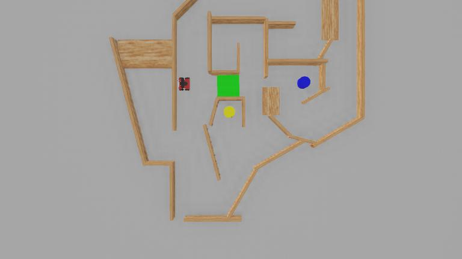

# Autonomous Maze Navigation with ROSbot and Webots

An autonomous robotics project in which a Husarion ROSbot explores five previously unknown maze environments, builds an internal map, detects colored targets and safely plans a route to the blue pillar followed by the yellow pillar.

The controller operates without the Webots Supervisor API, robot modifications or prior knowledge of the maze. It also avoids green floor regions and handles walls, floating obstacles and low-contact hazards.



## Project highlights

- Online occupancy-grid mapping from lidar observations
- Wheel-odometry localization with scan-matching correction
- Frontier-based exploration of unknown environments
- RGB and depth-based blue/yellow pillar detection
- Green-floor and floating-obstacle detection
- Cost-map generation and Dijkstra path planning
- Pure-pursuit path following, replanning and recovery behaviours
- Live Pygame visualization of the map, robot pose, obstacles and planned path
- Successful autonomous completion in all five test environments

## Results

| Environment | Start to Blue | Blue to Yellow | Total | Demo |
| --- | ---: | ---: | ---: | --- |
| Maze 1 | 2:23 | 0:55 | **3:18** | [Watch run](./Maze1_Full.mp4) |
| Maze 2 | 0:38 | 1:07 | **1:45** | [Watch run](./Maze2_Full.mp4) |
| Maze 3 | 1:40 | 0:46 | **2:26** | [Watch run](./Maze3_full.mp4) |
| Maze 4 | 1:53 | 1:15 | **3:08** | [Watch run](./Maze4_Full.mp4) |
| Maze 5 | 0:41 | 0:41 | **1:22** | [Watch run](./Maze5_Full.mp4) |

For the design, implementation and evaluation details, see the [project report](./Autonomous_Group_Z_ProjectReport.pdf).

## System overview

The controller continuously combines sensor readings and navigation decisions:

```text
Wheel encoders + lidar + RGB/depth camera
                    |
                    v
        Localization and perception
                    |
                    v
     Occupancy grid and semantic hazards
                    |
                    v
 Frontier exploration / Dijkstra planning
                    |
                    v
     Pure-pursuit control and recovery
                    |
                    v
                ROSbot motors
```

The mission state machine explores the environment, navigates to the blue pillar after both targets can be planned safely, then proceeds to the yellow pillar and stops.

## Repository structure

```text
.
|-- Maze1/ ... Maze5/
|   |-- controllers/script/
|   |   |-- script.py       # Sensors, mapping, perception and visualization
|   |   `-- navigator.py    # Planning, control and mission state machine
|   |-- protos/             # Custom Webots objects (where required)
|   `-- worlds/             # Webots maze environment
|-- Maze1_Full.mp4 ...      # Recorded autonomous runs
|-- Autonomous_Group_Z_ProjectReport.pdf
`-- requirements.txt
```

Each maze contains a separately tuned version of the same controller architecture.

## Requirements

- [Webots R2025a](https://cyberbotics.com/)
- Python 3
- NumPy, OpenCV, Pygame and SciPy

The `controller` Python module is supplied by Webots and should not be installed from PyPI.

Install the remaining Python packages into the Python environment used by Webots:

```bash
python -m pip install -r requirements.txt
```

## Run a simulation

1. Open Webots.
2. Open one of the world files, for example `Maze1/worlds/Maze1.wbt`.
3. Confirm that the ROSbot controller is set to `script`.
4. Start or reset the simulation.
5. The robot starts autonomously and a Pygame window displays its live internal map.

Repeat with `Maze2` through `Maze5` to test the other environments.

## Constraints

The assessed task required the robot to:

- reach the blue pillar before the yellow pillar;
- avoid all green floor regions;
- run without the Webots Supervisor API;
- use the supplied robot configuration; and
- navigate autonomously in every provided environment.

## Academic context

This repository presents a university Autonomous Robots project. It is shared as a portfolio and educational artifact; the implementation reflects the task constraints and simulation setup described above.
